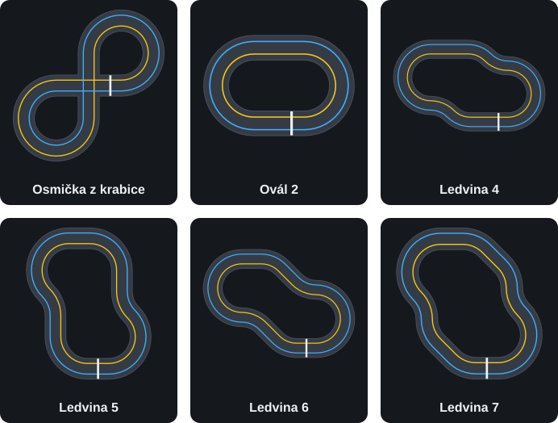

# Osmička

Časomíra pro obyčejnou analogovou autodráhu z hračkářství. Běží v prohlížeči telefonu a kola počítá **kamerou telefonu** nad cílovou rovinkou. Kola jde přidávat i klepáním na displej. Nepotřebuje žádný hardware, účet ani instalaci.

**Spustit:** https://albertbily14-blip.github.io/osmicka/
V telefonu přes *Sdílet → Přidat na plochu* se z ní stane aplikace s ikonou.



## Co umí

- **Start se semaforem**: pět červených světel, náhodná pauza, zelená. Za ulitý start je trest −1 kolo a kamera ho pozná sama.
- **Počítání kol kamerou**: telefon nad dráhou hlídá pro každou dráhu jednu zónu a hledá v ní **barvu svého auta**. Stíny, ruka nad dráhou ani drcnutí do dráhy kolo nezapočítají. Klepání na barevnou polovinu displeje funguje vždy jako záloha.
- **Závod na počet kol nebo na čas**: časy kol, nejrychlejší kolo, odstup, hlasové hlášení posledního kola a vítěze.
- **Turnaje každý s každým**: při odvetě se dráhy prohodí. Body: výhra 3, nejrychlejší kolo závodu +1.
- **Tratě z vašich dílků**: zadáš počet zatáček, rovinek a křížení a aplikace ukáže všechny okruhy, které z nich jdou uzavřít. Ukáže i to, co by šlo postavit s pár dílky navíc.
- **Rekordy pro každou trať zvlášť** a rychlost v km/h, včetně přepočtu na skutečnou velikost auta (třeba 1:43).
- **Odznaky pro jezdce**: Hattrick, Fotofiniš, Obrat, Hodinář, Rekordman, Šampion turnaje a další.

## Jak nastavit kameru

1. Upevni telefon nad cílovou rovinku zadní kamerou dolů (stojan, lampa, police).
2. V záložce **Kamera** zapni kameru a pro každou dráhu přetáhni zónu kousek **za startovní čáru**, aby v ní auta na startu nestála.
3. U každé dráhy klepni na **Naučit barvu** a pak na kapotu auta v obraze.
4. Zapni **Ukázat, co kamera vidí jako auto** a zkontroluj, že se obarví jen auta, ne podlaha nebo dráha.
5. Protlač každé auto zónou. Počítadlo průjezdů má skočit přesně o 1.

## Jak to funguje

**Detekce auta.** Obraz se zmenší na 160 bodů na šířku a v každé zóně se počítají body, jejichž odstín odpovídá naučené barvě auta. Body, které jsou moc tmavé (stín, černé plasty) nebo moc šedé (dráha, kolejnice, béžová podlaha), se nepočítají. Počítají se jen body, které mají barevné i sousední body, takže šum a barevné okraje stínů nevadí. Kolo se započítá ve chvíli, kdy auto zakryje nastavenou část zóny. Další kolo se může započítat až poté, co auto zónu opustí a uplyne nejkratší možný čas kola. Pro auta, která mají podobnou barvu jako dráha, je k dispozici i detekce podle pohybu.

**Generátor tratí.** `tools/trate.mjs` prochází všechny posloupnosti dílků: rovinka, zatáčka 45° doleva nebo doprava a křížení, které se projede dvakrát. Hledá ty, které se vrátí na start ve stejném směru a nikde se nepřekrývají. Geometrie vychází z originální osmičky: poloměr zatáčky je 1,5 délky rovinky a křížení je dlouhé jako rovinka. Tratě bez křížení musí uzavřít rovinky i zatáčky každé zvlášť, takže sedí i při trochu jiném poloměru zatáček.

Zajímavost: trať bez křížení má vždycky vnitřní dráhu kratší, a to o stejný kus, protože auto na ní celkem otočí o 360°. Férové pro obě dráhy jsou jen osmičky.

```bash
node tools/trate.mjs 16 6 > tools/trate.json   # všechny okruhy až z 16 zatáček a 6 rovinek (pár minut)
node tools/vyber.mjs                            # výběr do aplikace → tools/trate-vyber.json
node tools/plan.mjs                             # obrázek do README → docs/trate.svg
```

Výběr z `tools/trate-vyber.json` je vložený do `index.html` (konstanta `TRACKS`).

## Soukromí

Všechno zůstává v telefonu: jezdci, závody i turnaje se ukládají do úložiště prohlížeče. Obraz z kamery se zpracovává jen v telefonu a nikam se neodesílá. V záložce Garáž jde stáhnout a nahrát zálohu dat.

## Vývoj

Celá aplikace je jeden soubor `index.html`: čisté HTML, CSS a JavaScript bez knihoven a bez sestavování. Pro vyzkoušení na počítači:

```bash
python3 -m http.server 8000
```

Pak otevři http://localhost:8000. Kamera v prohlížeči funguje jen na `https://` nebo na `localhost`. Bez kamery jde závod ovládat klávesami **1** a **2** (průjezd dráhy) a **mezerníkem** (start).

Nápady a chyby piš do [Issues](https://github.com/albertbily14-blip/osmicka/issues).

## Licence

[MIT](LICENSE)

---

### English

**Osmička** ("figure eight") is a lap timer for cheap analog slot car sets. It runs in the phone browser and counts laps with the **phone camera** held above the finish straight. Each lane has a zone that looks for its own car's colour, so shadows, hands and bumps don't count. It also does F1-style start lights, round-robin tournaments, per-track records, driver achievements and a track generator that lists every layout you can build from your pieces. Single HTML file, no build, no backend; all data stays on the device. UI is in Czech. Live: https://albertbily14-blip.github.io/osmicka/
